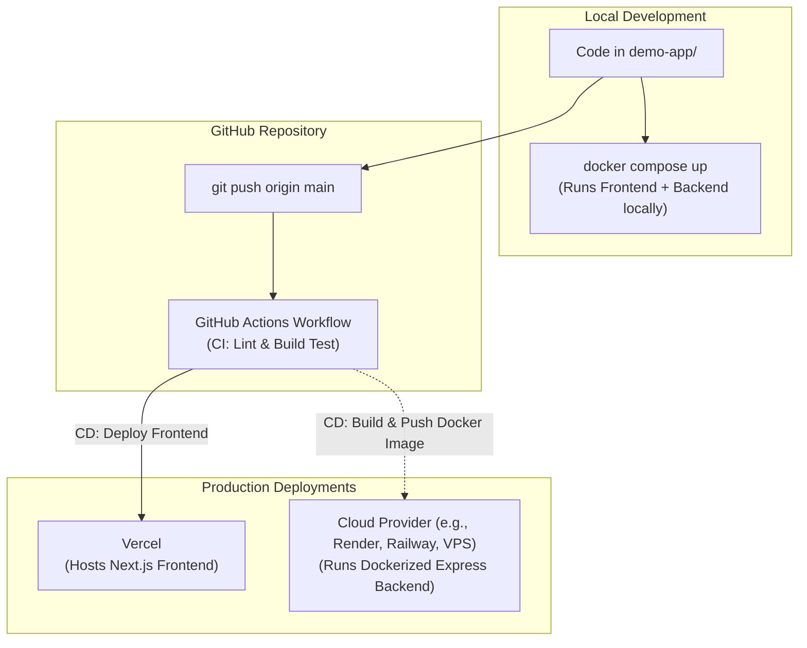

# Full-Stack DevOps Guide: Docker & GitHub Actions CI/CD with Vercel

Welcome to the learning guide for **Dockerizing** your full-stack application and setting up automated **CI/CD with GitHub Actions and Vercel**.

This guide is tailored specifically to your project setup:
- **Frontend**: Next.js (App Router, JavaScript)
- **Backend**: Node.js + Express (`PORT=5000`)

---

## Table of Contents
1. [Architecture Overview](#1-architecture-overview)
2. [Part 1: Understanding Docker](#2-part-1-understanding-docker)
   - [Core Concepts (Image vs Container)](#core-concepts)
   - [Dockerizing the Backend (Express)](#dockerizing-the-backend-express)
   - [Dockerizing the Frontend (Next.js Multi-Stage Build)](#dockerizing-the-frontend-nextjs)
   - [Connecting Both with Docker Compose](#connecting-both-with-docker-compose)
   - [Essential Docker Commands Cheatsheet](#essential-docker-commands-cheatsheet)
3. [Part 2: CI/CD & Automated Vercel Deployment](#3-part-2-cicd--automated-vercel-deployment)
   - [What is CI/CD?](#what-is-cicd)
   - [Why GitHub Actions with Vercel?](#why-github-actions-with-vercel)
   - [Setting Up Vercel Secrets in GitHub](#setting-up-vercel-secrets-in-github)
   - [Understanding the Workflow YAML File](#understanding-the-workflow-yaml-file)
4. [Part 3: Roadmap & Next Steps](#4-part-3-roadmap--next-steps)

---

## 1. Architecture Overview

Here is how code flows from your local machine to production:



---

## 2. Part 1: Understanding Docker

### Core Concepts

Think of Docker like shipping physical goods:
- **Dockerfile**: The recipe / blueprint. It defines the base OS, dependencies to install, and the command to run.
- **Docker Image**: The packaged blueprint (read-only snapshot). You can share this image on Docker Hub or GitHub Packages.
- **Docker Container**: A running instance of an image. If the image is a class, the container is an object running in memory.
- **.dockerignore**: Similar to `.gitignore`, it prevents heavy or sensitive files (like `node_modules` and `.env`) from being copied into the container image.
- **Docker Compose**: A tool to run multiple containers together using a single YAML configuration file (`docker-compose.yml`).

---

### Dockerizing the Backend (Express)

For Express, the Dockerfile is simple and lightweight:

#### `backend/Dockerfile`
```dockerfile
# 1. Use official lightweight Node.js image
FROM node:20-alpine

# 2. Set the working directory inside the container
WORKDIR /app

# 3. Copy package manifests first (Docker caches layer if dependencies don't change)
COPY package*.json ./

# 4. Install production dependencies
RUN npm ci --only=production

# 5. Copy the rest of the backend source code
COPY . .

# 6. Expose the port the Express app runs on
EXPOSE 5000

# 7. Start the server
CMD ["node", "index.js"]
```

#### `backend/.dockerignore`
```
node_modules
npm-debug.log
.env
```

---

### Dockerizing the Frontend (Next.js)

Next.js is typically built using **Multi-Stage Builds** to keep the final image as small as possible (dropping build tools and source files, keeping only the compiled standalone output):

#### `frontend/Dockerfile`
```dockerfile
# --- Stage 1: Dependencies ---
FROM node:20-alpine AS deps
WORKDIR /app
COPY package*.json ./
RUN npm ci

# --- Stage 2: Builder ---
FROM node:20-alpine AS builder
WORKDIR /app
COPY --from=deps /app/node_modules ./node_modules
COPY . .
# Set environment to production during build
ENV NODE_ENV=production
RUN npm run build

# --- Stage 3: Runner ---
FROM node:20-alpine AS runner
WORKDIR /app
ENV NODE_ENV=production

# Copy built public and standalone assets
COPY --from=builder /app/public ./public
COPY --from=builder /app/.next/standalone ./
COPY --from=builder /app/.next/static ./.next/static

EXPOSE 3000
CMD ["node", "server.js"]
```

> **Note**: To use Next.js standalone output, we set `output: "standalone"` in `frontend/next.config.mjs`.

#### `frontend/.dockerignore`
```
node_modules
.next
out
.git
.env*.local
```

---

### Connecting Both with Docker Compose

Rather than starting both containers manually with long terminal commands, we use `docker-compose.yml` at the project root:

#### `docker-compose.yml`
```yaml
version: '3.8'

services:
  backend:
    build:
      context: ./backend
      dockerfile: Dockerfile
    ports:
      - "5000:5000"
    environment:
      - PORT=5000
    restart: unless-stopped

  frontend:
    build:
      context: ./frontend
      dockerfile: Dockerfile
    ports:
      - "3000:3000"
    environment:
      - NEXT_PUBLIC_API_URL=http://localhost:5000
    depends_on:
      - backend
    restart: unless-stopped
```

With this in place, running **`docker compose up --build`** launches your entire full-stack system!

---

### Essential Docker Commands Cheatsheet

| Command | What it does |
| :--- | :--- |
| `docker build -t my-app .` | Build an image tagged `my-app` from current folder |
| `docker run -p 5000:5000 my-app` | Run image as a container mapping host port 5000 |
| `docker ps` | List all running containers |
| `docker compose up -d` | Start all services in the background (detached mode) |
| `docker compose down` | Stop and remove all containers defined in compose file |
| `docker compose logs -f` | Stream live logs from all services |

---

## 3. Part 2: CI/CD & Automated Vercel Deployment

### What is CI/CD?
- **CI (Continuous Integration)**: Automatically tests, validates, and builds code whenever a developer pushes a commit or creates a pull request.
- **CD (Continuous Deployment / Delivery)**: Automatically releases the validated code to staging or production without human intervention.

### Why GitHub Actions with Vercel?
While Vercel has a direct GitHub integration, using **GitHub Actions** gives you complete control over your delivery pipeline:
1. You can run automated tests (linting, unit tests, security audits) **before** Vercel deploys.
2. If tests fail on GitHub Actions, Vercel never deploys broken code to your live URL.
3. You can coordinate frontend and backend deployment pipelines together.

---

### Setting Up Vercel Secrets in GitHub

To deploy to Vercel programmatically from GitHub Actions, you need 3 credentials stored as **GitHub Repository Secrets**:

1. **`VERCEL_TOKEN`**: A personal access token generated in your [Vercel Account Settings > Tokens](https://vercel.com/account/tokens).
2. **`VERCEL_ORG_ID`**: Found in your Vercel team/account settings (or generated automatically via `vercel link`).
3. **`VERCEL_PROJECT_ID`**: Found in your Vercel Project Settings > General (or generated automatically via `vercel link`).

You add these in GitHub:
`Repository -> Settings -> Secrets and variables -> Actions -> New repository secret`

---

### Understanding the Workflow YAML File

GitHub Actions looks for files inside `.github/workflows/`. Here is the production workflow:

#### `.github/workflows/frontend-deploy.yml`
```yaml
name: Deploy Frontend to Vercel

on:
  push:
    branches:
      - main
    paths:
      - 'frontend/**'
      - '.github/workflows/frontend-deploy.yml'

jobs:
  deploy:
    runs-on: ubuntu-latest
    steps:
      # Step 1: Check out the repository code
      - name: Checkout Code
        uses: actions/checkout@v4

      # Step 2: Set up Node.js environment
      - name: Setup Node.js
        uses: actions/setup-node@v4
        with:
          node-version: 20
          cache: 'npm'
          cache-dependency-path: 'frontend/package-lock.json'

      # Step 3: Install frontend dependencies
      - name: Install Dependencies
        run: |
          cd frontend
          npm ci

      # Step 4: Run linter to ensure code quality
      - name: Run Lint
        run: |
          cd frontend
          npm run lint

      # Step 5: Install Vercel CLI
      - name: Install Vercel CLI
        run: npm install --global vercel@latest

      # Step 6: Pull Vercel environment information
      - name: Pull Vercel Environment Information
        run: |
          cd frontend
          vercel pull --yes --environment=production --token=${{ secrets.VERCEL_TOKEN }}

      # Step 7: Build Project Artifacts
      - name: Build Project Artifacts
        run: |
          cd frontend
          vercel build --prod --token=${{ secrets.VERCEL_TOKEN }}

      # Step 8: Deploy Prebuilt Artifacts to Vercel
      - name: Deploy to Vercel
        run: |
          cd frontend
          vercel deploy --prebuilt --prod --token=${{ secrets.VERCEL_TOKEN }}
```

### How the Workflow Triggers:
1. Whenever you run `git push origin main`, GitHub detects the push.
2. It spins up an isolated Ubuntu Linux runner.
3. It installs dependencies, runs `npm run lint`.
4. If everything passes, it builds the Next.js bundle and publishes it straight to your live Vercel domain!

---

## 4. Part 3: Roadmap & Next Steps

When you're ready to start implementing, we will follow these steps:

- [ ] **Step 1**: Create `Dockerfile` and `.dockerignore` for `backend/`.
- [ ] **Step 2**: Create `Dockerfile` and `.dockerignore` for `frontend/` (configure standalone output).
- [ ] **Step 3**: Create `docker-compose.yml` and test the full-stack container locally.
- [ ] **Step 4**: Set up `.github/workflows/frontend-deploy.yml` for Vercel deployment.
- [ ] **Step 5**: Link your GitHub repository to Vercel and test the live push-to-deploy workflow!
